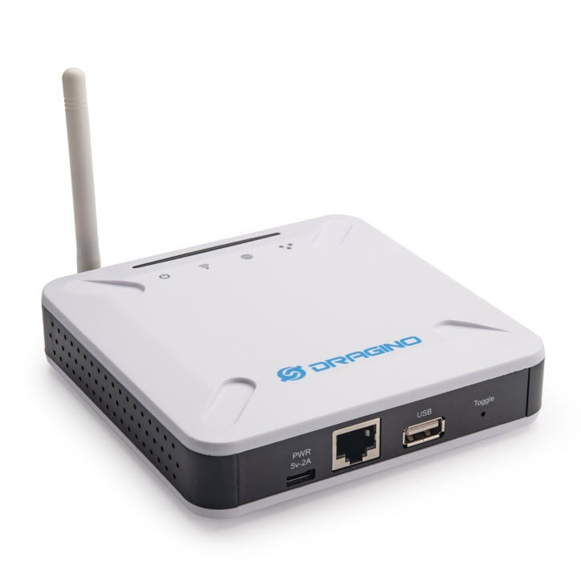
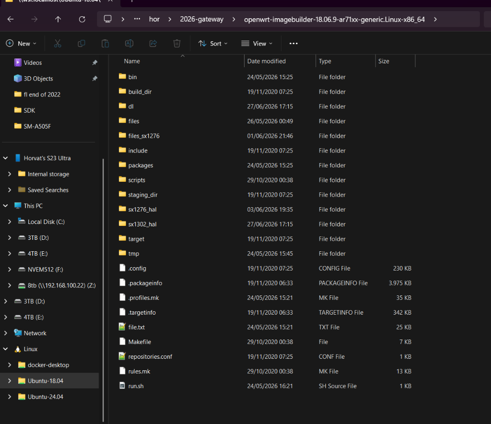
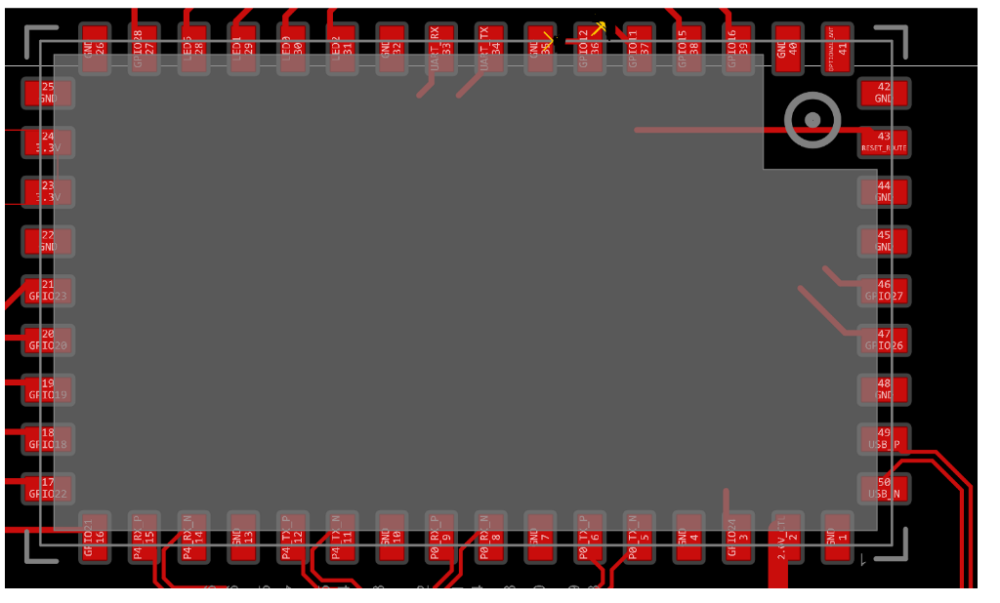
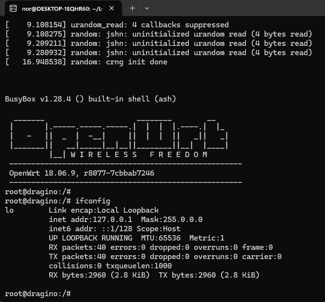
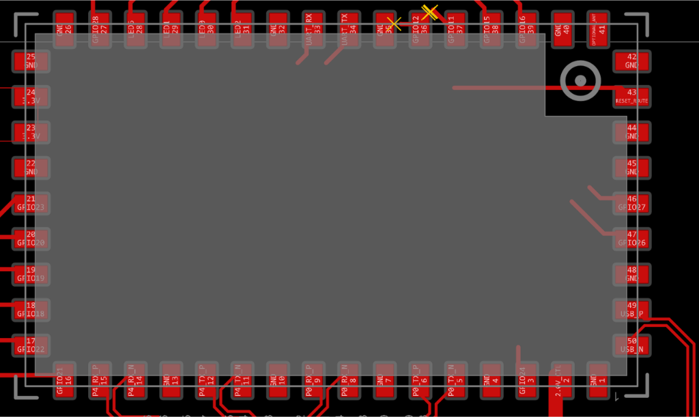
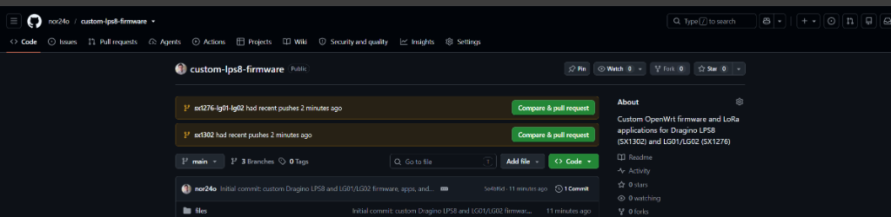

# Custom Dragino Firmware & Architecture Specification

Comprehensive technical architecture, hardware pinout, SPI bit-banging specification, Semtech SX1302 HAL integration, network behavior, and wire protocol for the custom Dragino firmware stack on the **Dragino LPS8** (SX1302), **Dragino LG02** (Dual SX1276), and **Dragino LG01** (Single SX1276).

---

## 1. Hardware System Overview & Component Photos

The Dragino gateway series is built upon a modular architecture consisting of the **Dragino HE Core CPU Module** running OpenWrt Linux, interconnected via GPIO/SPI with Semtech LoRa concentrator hardware.

| Component / Subsystem | Dragino LPS8 | Dragino LG02 | Dragino LG01 |
|---|---|---|---|
| **Core Processor** | Qualcomm Atheros AR9331 (MIPS 24Kc @ 400 MHz, Big-Endian) | AR9331 (MIPS 24Kc @ 400 MHz) | AR9331 (MIPS 24Kc @ 400 MHz) |
| **System Memory (RAM)** | 64 MB DDR2 (integrated on HE module) | 64 MB DDR2 | 64 MB DDR2 |
| **Storage (SPI Flash)** | 16 MB SPI NOR Flash (dedicated hardware SPI) | 16 MB SPI NOR Flash | 16 MB SPI NOR Flash |
| **LoRa Silicon** | Semtech SX1302 Concentrator + 2x SX1250 RF Front-Ends | 2x Semtech SX1276/78 Transceivers | 1x Semtech SX1276/78 Transceiver |
| **Channel Capacity** | 8 Multi-SF channels (SF5–SF12) + 1 LoRa Std + 1 FSK | 2 Independent single-channel radios (1 RX + 1 TX) | 1 Single-channel radio (half-duplex) |
| **Concentrator Bus** | Linux bit-banged SPI (`/dev/spidev1.0`) | Dual bit-banged SPI (`/dev/spidev1.0` & `spidev1.1`) | Bit-banged SPI (`/dev/spidev1.0`) |
| **RF Front-End / PA** | External Skyworks PA/LNA Switch (`dragino2:red:wan` / GPIO 17) | Direct SX1276 PA output | Direct SX1276 PA output |
| **Wired Network** | 1x RJ45 Ethernet Port (`eth0`, 10/100 Mbps) | 2x RJ45 Ethernet Ports (`eth0` + `eth1`, 10/100 Mbps) | 2x RJ45 Ethernet Ports (`eth0` + `eth1`, 10/100 Mbps) |
| **Wireless Network** | 2.4 GHz 802.11b/g/n WiFi (`ath9k`, AP / STA modes) | 2.4 GHz 802.11b/g/n WiFi (`ath9k`) | 2.4 GHz 802.11b/g/n WiFi (`ath9k`) |
| **Interactive App** | [Interactive Pinout Viewer](docs/pinout.html) | [Interactive Pinout Viewer](docs/pinout.html) | [Interactive Pinout Viewer](docs/pinout.html) |

### Real Hardware Visuals


*Figure 1: Dragino LPS8 Indoor LoRaWAN Gateway (Front Perspective)*


*Figure 2: Dragino Gateway System Architecture & Interconnect*

---

## 2. Dragino HE Module & Carrier Motherboard Pinout

The **Dragino HE (Hardware Environment)** core module encapsulates the Atheros AR9331 SoC, 64 MB DDR2 RAM, 16 MB SPI Flash, and 2.4 GHz WiFi frontend. Because hardware SPI on the AR9331 SoC is dedicated to the onboard Flash memory, the LoRa radio concentrator is driven via Linux bit-banged SPI (`kmod-spi-gpio-custom`).


*Figure 3: Dragino HE 50-Pad Perimeter Footprint (Factory Altium / KiCad CAD Layout)*


*Figure 4: Dragino HE (AR9331) 48-Pin Physical Layout*


*Figure 5: Dragino LPS8 Carrier Motherboard Interconnect Schematic*

### 2.1 Complete Pin Mapping Table

| HE Module Pin | AR9331 Signal | Subsystem Function | Linux Driver / Kernel Node | Configuration File Key | Circuit Behavior |
|:---:|:---:|:---|:---|:---|:---|
| **Pin 3** | `GPIO 24` | **SPI SCK (Clock)** | `kmod-spi-gpio-custom` (bus0) | — | 8 MHz bit-banged master clock line to concentrator. |
| **Pin 18** | `GPIO 18` | **SPI MOSI** | `kmod-spi-gpio-custom` (bus0) | — | Master-Out Slave-In data line driving concentrator commands. |
| **Pin 20** | `GPIO 20` | **SPI MISO** | `kmod-spi-gpio-custom` (bus0) | — | Master-In Slave-Out data line reading received LoRa packets. |
| **Pin 19** | `GPIO 19` | **Radio 1 CS0 (NSS)** | `/dev/spidev1.0` | `"spi_path": "/dev/spidev1.0"` | Active-low Chip Select for SX1302 (LPS8) or Radio 1 (LG01/LG02). |
| **Pin 38** | `GPIO 15` | **Radio 2 CS1 (NSS)** | `/dev/spidev1.1` | `"spi_path": "/dev/spidev1.1"` | Active-low Chip Select for Radio 2 on dual-channel LG02. |
| **Pin 21** | `GPIO 23` | **Hardware RESET** | `/sys/class/gpio/gpio23` | `"reset_gpio": "23"` | Active-high pulse (100ms HIGH, 100ms LOW) to initialize silicon. |
| **Pin 23** | `GPIO 17` | **PA/LNA Switch** | `/sys/class/leds/dragino2:red:wan` | `"pa_gpio": "dragino2:red:wan"` | Driven LOW during TX (PA enabled) and HIGH during RX (LNA enabled). |
| **Pin 12** | `GPIO 0` | **WLAN LED** | `/sys/class/leds/dragino2:red:wlan` | `"led_rx": "dragino2:red:wlan"` | Visual packet RX indicator (80ms pulse). |
| **Pin 26** | `GPIO 13` | **LAN LED** | `/sys/class/leds/dragino2:red:lan` | `"led_tx": "dragino2:red:lan"` | Visual packet TX indicator (200ms pulse). |
| **Pins 1,2,4,5** | `eth0` | **Primary RJ45 Port** | `ag71xx MAC0 (Port 4)` | `/etc/config/network` (br-lan) | Bridged into `br-lan` as a DHCP client. |
| **Pins 29,30,32,33** | `eth1` | **Secondary RJ45 Port** | `ag71xx MAC1 (Port 0)` | `/etc/config/network` (br-lan) | Bridged with `eth0` on LG01/LG02 (both ports act as flat LAN switch). |
| **Internal RF** | `wlan0` | **2.4 GHz 802.11b/g/n** | `kmod-ath9k` (`ar933x_wmac`) | `/etc/config/wireless` | Managed via LuCI (Network -> Wireless); supports AP and Client STA. |
| **Pin 7 / 8** | `GPIO 10/9` | **Serial Console UART** | `/dev/ttyATH0` | U-Boot / Kernel Console | 115200 8N1 serial console for low-level recovery. |
| **Pin 15** | `GPIO 7` | **SX1276 DIO0** | `/sys/class/gpio/gpio7` | `"dio0_gpio": "7"` | SX1276 packet interrupt on LG01/LG02; free GPIO on LPS8. |
| **Pin 16** | `GPIO 8` | **Radio 1 Reset** | `/sys/class/gpio/gpio8` | `"rst_gpio": "8"` | Primary SX1276 reset on LG02; free GPIO on LPS8. |
| **Pins 13,14,22,27** | `GPIO 6,21,22,27` | **Free Digital I/O** | `/sys/class/gpio/gpio*` | User expansion | Unclaimed AR9331 digital GPIOs available for custom accessories. |
| **Pins 35 & 36** | `GND & GPIO 12` | **Disconnected (X)** | None | None | **Crossed out on carrier PCB layout; left floating.** |

### 2.2 Kernel SPI Module Initialization

The Linux bit-banged SPI module is loaded during boot via `/etc/init.d/spi_init` and `/etc/modules.d/30-spi-gpio-custom`:

```bash
# insmod spi-gpio-custom bus<Y>=<bus_id>,<sck>,<mosi>,<miso>,<mode>,<max_freq>,<cs0_gpio>,<mode>,<max_freq>,<cs1_gpio>
insmod spi-gpio-custom bus0=1,24,18,20,0,8000000,19,0,8000000,15
```

This creates:
- `/dev/spidev1.0` -> Primary Concentrator (CS0 = GPIO 19)
- `/dev/spidev1.1` -> Secondary Radio (CS1 = GPIO 15, for LG02 dual-channel)

---

## 3. Firmware Bloat Elimination & Network Architecture

To maximize stability, packet forwarding throughput, and security on a 64 MB RAM MIPS gateway, all standard OpenWrt routing bloat has been stripped out:

```bash
# Excluded from ImageBuilder:
-dnsmasq -firewall -iptables -ip6tables -odhcpd -odhcpd-ipv6only -odhcp6c -ppp -ppp-mod-pppoe
```

### Pure DHCP Client Network Topology:
- **No DHCP Server**: The gateway never hands out IP addresses or runs a local DNS server.
- **No Firewall**: No NAT, connection tracking, or packet dropping.
- **Bridged Flat LAN**: Both `eth0` and `eth1` (on dual-ethernet models) are bonded together in `br-lan` under `/etc/config/network`:
  ```uci
  config interface 'lan'
      option type 'bridge'
      option ifname 'eth0 eth1'
      option proto 'dhcp'
  ```
- **IP Acquisition**: When plugged into any upstream local network switch or router, the gateway requests an IP address via DHCP. The LuCI web interface is immediately accessible at that assigned IP address.
- **Default HTTP Redirect**: Accessing `http://<ip>/` automatically redirects to `/cgi-bin/luci/admin/lora` (the native LoRa Gateway management tab).

---

## 4. Software Architecture & Daemon Structure (`raw_lora_app`)

The core packet forwarder `raw_lora_app` is an optimized, multi-threaded C application compiled for `mips-openwrt-linux-musl` that interfaces with Semtech's `libloragw` (HAL 2.1.0) and serves real-time telemetry to the LuCI interface.


*Figure 5: Semtech SX1302 Concentrator Architecture & RF Distribution*

### 4.1 Threading Model

```
                            ┌─────────────────────────────────────────┐
                            │          raw_lora_app Process           │
                            └────────────────────┬────────────────────┘
                                                 │
          ┌───────────────┬──────────────────────┼──────────────────────┬────────────────┐
          ▼               ▼                      ▼                      ▼                ▼
   ┌─────────────┐ ┌─────────────┐        ┌─────────────┐        ┌─────────────┐  ┌─────────────┐
   │thread_rx_   │ │thread_tx_   │        │thread_tx_   │        │thread_heart-│  │thread_status│
   │loop         │ │recv (UDP)   │        │dispatch     │        │beat (UDP)   │  │_server(TCP) │
   └──────┬──────┘ └──────┬──────┘        └──────┬──────┘        └──────┬──────┘  └──────┬──────┘
          │               │                      │                      │                │
          ▼               ▼                      ▼                      ▼                ▼
     lgw_receive     recvfrom(:5556)        lgw_send()             send_uplink()     bind(:5557)
     Uplink JSON     Enqueue Packet       PA switch (LOW)        Binary Datagram     JSON Status
     /tmp/lora_      Instant Abort        Wait TX_FREE            Uptime, RX, TX      LuCI AJAX
     packets.json    CW Tone Mode         PA switch (HIGH)        Concentrator Temp   Live Stream
```

1. **`thread_rx_loop`**: Polling `lgw_receive()` every 5ms. Formats received LoRa/FSK packets into JSON `rxpk` frames, sends them to `target_ip:port_up` via UDP, updates runtime stats, and writes the latest 25 packets into `/tmp/lora_packets.json` for LuCI's live stream.
2. **`thread_tx_recv`**: Listens on UDP port `5556` for downlink requests. Parses Semtech JSON packets, validates timing/frequency, handles Instant TX Aborts (`{"abort": true}`), Continuous Wave RF tone requests (`MOD_CW`), and queues packets into the ring buffer.
3. **`thread_tx_dispatch`**: Dequeues transmission requests, asserts PA switch (`dragino2:red:wan` LOW), initiates transmission via `lgw_send()`, waits for over-air completion, and releases the PA switch.
4. **`thread_heartbeat`**: Periodically (default: 10s) transmits binary heartbeat datagrams (`PKT_TYPE_HEARTBEAT` 0x02) to `target_ip:port_up`, polls concentrator temperature via `lgw_get_temperature()`, and performs MCU AGC/ARB health checks via `sx1302_update()`.
5. **`thread_status_server`**: Listens on TCP port `5557` (localhost). When connected, immediately emits a comprehensive JSON status object (`eui`, `uptime_s`, `rx`, `tx`, `crc_err`, `tx_err`, `q_depth`, `temp_c`, `inst_cnt_us`, `tx_status`, `rx_status`, `ch_detect`) and closes the connection.
6. **`thread_led`**: Asynchronous LED blinking thread that triggers visual feedback without blocking the RF paths.

---

## 5. 3-Layer Keepalive & Self-Healing Watchdog System

To guarantee unattended 24/7 reliability in remote industrial or tower installations:

```
┌─────────────────────────────────────────────────────────────────────────────┐
│                       3-LAYER RECOVERY ARCHITECTURE                         │
├─────────────────────────────────────────────────────────────────────────────┤
│  Layer 1: Procd Process Respawn Supervision (/etc/init.d/lora_gateway)       │
│  - Configured with `procd_set_param respawn 3600 5 0`                       │
│  - Instant automatic restart if process crashes or exits.                   │
├─────────────────────────────────────────────────────────────────────────────┤
│  Layer 2: External Background Monitor (/usr/bin/lora_keepalive.sh)          │
│  - Inspects PID of raw_lora_app every 15 seconds.                           │
│  - Respects manual stop lock (/tmp/lora_manual_stop) to allow web config.   │
│  - Net watchdog (/usr/bin/net_watchdog.sh via cron) monitors upstream ping. │
├─────────────────────────────────────────────────────────────────────────────┤
│  Layer 3: Internal Daemon Hardware Watchdog (raw_lora_app.c)                │
│  - 10 Consecutive HAL Errors -> Calls reset_sx1302() & restarts concentrator│
│  - Network Outage -> Reconnects UDP socket & retransmits PKT_TYPE_BOOT       │
└─────────────────────────────────────────────────────────────────────────────┘
```

---

## 6. Semtech SX1302 HAL 2.1.0 Features Integrated

All features of the Semtech SX1302 HAL have been added as optional, backwards-compatible capabilities:

1. **Live Concentrator Temperature**: Polled via `lgw_get_temperature()` and reported in LuCI and status JSON.
2. **Hardware 1-µs Counter & PPS Tracking**: Accessible via `lgw_get_instcnt()` and `lgw_get_trigcnt()`.
3. **Live Radio State & Demodulator Allocation**: Queried via `lgw_status(0, TX_STATUS)` / `RX_STATUS` and `sx1302_arb_get_debug_stats_detect(ch)`.
4. **Extended RX RF Metadata**: Reports noise floor (`rssic`), SNR range (`snr_min..snr_max`), frequency offset (`foff` Hz), payload CRC, and hex payload preview.
5. **Class A/B Timestamped Downlinks**: Supports microsecond-exact `tmst` downlinks (`TIMESTAMPED` / `ON_GPS`).
6. **Continuous Wave (CW Tone) Generation**: Allows carrier wave RF testing via `"modu": "CW"`.
7. **Instant Transmission Abort**: Call `lgw_abort_tx()` on demand via downlinks or LuCI UI.
8. **Selective Multi-SF Demodulator Mask**: Selectively enable/disable SF5 through SF12 via `sf_mask` bitmask.
9. **Periodic MCU AGC/ARB Health Check**: Routine `sx1302_update()` calls.
10. **LoRa Std Implicit Header & FSK Sync**: Supports implicit header length/CRC and customizable FSK sync words.

---

## 7. Wire Protocols & Interface Ports

### 7.1 Uplink UDP Wire Protocol (Gateway -> Server / PC)
- **Port**: UDP `5555`
- **Packet Types**:
  - `0x03` (`PKT_TYPE_BOOT`): Emitted on daemon startup and network recovery. Contains gateway EUI and HAL version.
  - `0x02` (`PKT_TYPE_HEARTBEAT`): Emitted every `heartbeat_interval_s`. Binary packed struct containing uptime, packet counters, error counters, queue depth, and RF center frequencies.
  - Semtech JSON `rxpk`: Standard LoRaWAN uplink frame format with extended RF parameters.

### 7.2 Downlink UDP Wire Protocol (Server / PC -> Gateway)
- **Port**: UDP `5556`
- **Format**: JSON object supporting `imme` (immediate), `tmst` (hardware microsecond timestamped), `freq`, `rfch`, `powe`, `modu` (`LORA`, `FSK`, `CW`), `datr`, `codr`, `ipol`, `data` (Base64 payload), or `abort` (`true`).

### 7.3 Status TCP Protocol (LuCI AJAX -> Gateway)
- **Port**: TCP `5557` (localhost)
- **Format**: Instant JSON string output containing complete live telemetry.
