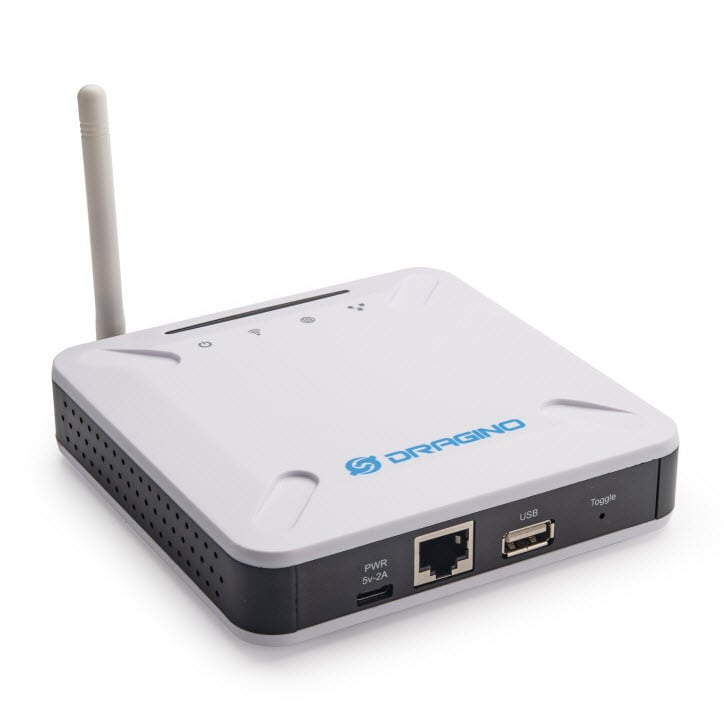
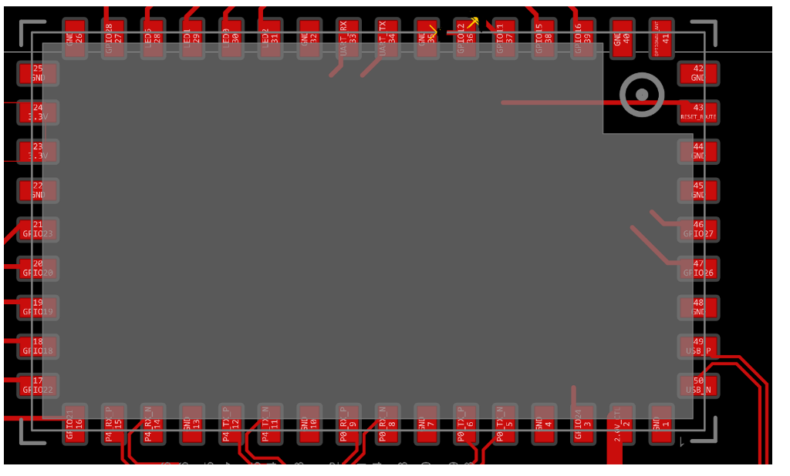
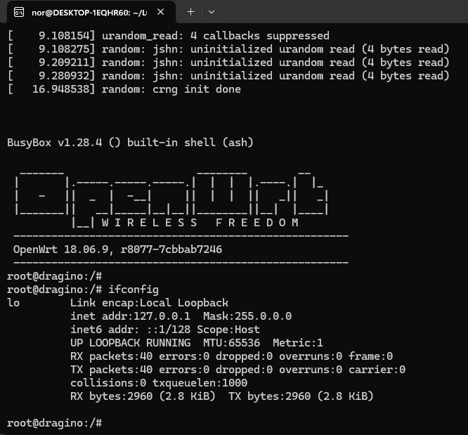
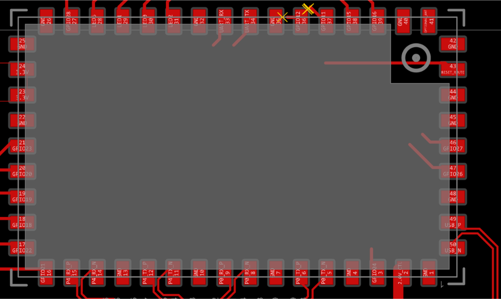

# Custom Dragino LoRa Gateway Firmware & Applications

A lean, high-performance, and unified firmware build system and custom application stack for **Dragino LoRa Gateways** based on the Qualcomm Atheros AR9331 SoC (`ar71xx-generic`):
- **Dragino LPS8**: 8-Channel Multi-SF LoRaWAN Concentrator (Semtech SX1302 + 2x SX1250)
- **Dragino LG02**: Dual-Channel LoRa Gateway (2x Semtech SX1276/78)
- **Dragino LG01**: Single-Channel LoRa Gateway (1x Semtech SX1276/78)

---

## Real Hardware Overview

<p align="center">
  
  <br>
  <em>Dragino LPS8 Indoor LoRaWAN Gateway (Atheros AR9331 + Semtech SX1302)</em>
</p>

### Key Features:
- **Zero Bloatware / Pure Client**: Completely excludes `dnsmasq`, `firewall`, `iptables`, `ip6tables`, `odhcpd`, `ppp`, and routing bloat. The device behaves as a transparent DHCP client on `br-lan` without offering routing or DHCP services.
- **Real-Time Pin & GPIO Diagnostics Page**: Built directly into LuCI (**LoRa Gateway -> Pin & GPIO Diagnostics**) showing the live electrical logic level (HIGH/LOW/3.3V/GND/NC), direction (IN/OUT), and driver binding for all 50 physical pads of the Dragino HE module in real-time. Includes safe interactive controls to toggle or pulse free digital GPIOs.
- **Interactive Pinout & Architecture Viewer**: Open [`docs/pinout.html`](docs/pinout.html) in your browser or through the LuCI web interface (**LoRa Gateway -> Hardware Pinout & Map**) for an interactive pin-by-pin inspector and schematic viewer.
- **3-Layer Self-Healing Keepalive**:
  1. *Layer 1 (Procd)*: Instant process respawn supervision via `/etc/init.d/lora_gateway`.
  2. *Layer 2 (Supervisor)*: External background watchdog (`/usr/bin/lora_keepalive.sh` & `/usr/bin/net_watchdog.sh`).
  3. *Layer 3 (Hardware Watchdog)*: Concentrator hardware auto-reset after 10 consecutive HAL errors and UDP socket auto-reconnection upon network recovery.
- **Full Semtech SX1302 HAL 2.1.0 Feature Set**: Concentrator temperature monitoring, 1-µs hardware timestamp counter, live radio status (`TX_STATUS`/`RX_STATUS`), extended RF metadata (channel noise floor `rssic`, SNR dynamic range `snr_min..snr_max`, frequency offset `foff` Hz, hex payload preview), microsecond timestamped downlinks, Continuous Wave RF tone generator (`MOD_CW`), instant transmission abort (`lgw_abort_tx`), and selective multi-SF mask (`sf_mask`).
- **Native LuCI Web Interface**: Dedicated top-level navigation tab **"LoRa Gateway"** containing Realtime Status, Pin & GPIO Diagnostics, Settings & Config, Hardware Pinout & Map, and Gateway Logs.
- **2.4 GHz WiFi**: Powered by `kmod-ath9k`, `wpad-mini`, and `iwinfo` for Access Point or Client (STA) uplink backhaul.

---

## Hardware Schematics, CAD Layout & Pinout Diagnostics

<p align="center">
  
  <br>
  <em>Dragino HE 50-Pad Perimeter Footprint (Factory Altium / KiCad CAD Layout)</em>
</p>

<p align="center">
  
  &nbsp;&nbsp;
  
  <br>
  <em>Left: Dragino HE Core Module Pinout | Right: LPS8 Motherboard Carrier Schematic</em>
</p>

### Launch Interactive Pinout Viewer
Open [`docs/pinout.html`](docs/pinout.html) directly in any browser (or navigate to `/pinout.html` on your running gateway) to explore:
- Interactive click-to-inspect pin mapping.
- High-resolution board photos and schematics.
- Linux driver commands (`spi-gpio-custom`, `/dev/spidev1.0`, `/dev/spidev1.1`).
- Subsystem filtering (SX1302, SX1276, Ethernet/WiFi, LEDs, Free GPIOs).

### Core Pinout Reference

| HE Pin | Signal | Subsystem | Linux Node / Driver | Notes |
|:---:|:---:|:---|:---|:---|
| **Pin 3** | `GPIO 24` | SPI SCK (Clock) | `kmod-spi-gpio-custom` | 8 MHz bit-banged SPI clock |
| **Pin 18** | `GPIO 18` | SPI MOSI | `kmod-spi-gpio-custom` | Master Out Slave In |
| **Pin 20** | `GPIO 20` | SPI MISO | `kmod-spi-gpio-custom` | Master In Slave Out |
| **Pin 19** | `GPIO 19` | Radio 1 CS0 (NSS) | `/dev/spidev1.0` | Concentrator Chip Select 0 |
| **Pin 38** | `GPIO 15` | Radio 2 CS1 (NSS) | `/dev/spidev1.1` | LG02 Dual-Radio Chip Select 1 |
| **Pin 21** | `GPIO 23` | Hardware RESET | `/sys/class/gpio/gpio23` | Active-high reset pulse |
| **Pin 23** | `GPIO 17` | PA/LNA RF Switch | `/sys/class/leds/dragino2:red:wan` | Driven LOW during TX, HIGH during RX |
| **Pins 1,2,4,5** | `eth0` | Primary RJ45 Port | `ag71xx MAC0` | Bridged into `br-lan` (DHCP client) |
| **Pins 29,30,32,33** | `eth1` | Secondary RJ45 Port | `ag71xx MAC1` | Bridged into `br-lan` (LG01/LG02) |
| **Internal RF** | `wlan0` | 2.4 GHz WiFi | `kmod-ath9k` | 802.11b/g/n Client (STA) or AP |
| **Pin 35** | `GND` | Ground | Ground Plane | **Digital ground plane connection.** |
| **Pin 36** | `GPIO 12` | Free Digital I/O | `/sys/class/gpio/gpio12/value` | **Free digital I/O for sensors, relays, or expansion.** |

---

## Repository & Branch Structure

```
                      ┌────────────────────────────────────────┐
                      │              main branch               │
                      │  - Unified Build Dispatcher (build.sh) │
                      │  - Environment Setup (setup_env.sh)    │
                      │  - Master Documentation & Pinout App   │
                      │  - PC Test Console (run.py)            │
                      │  - Both Targets in targets/            │
                      └──────────────────┬─────────────────────┘
                                         │
                 ┌───────────────────────┴───────────────────────┐
                 ▼                                               ▼
┌───────────────────────────────────┐           ┌───────────────────────────────────┐
│           sx1302 branch           │           │     sx1276-lg01-lg02 branch       │
│  - Dragino LPS8 (8-Channel SX1302)│           │  - Dragino LG01 & LG02 (SX1276)   │
│  - libloragw HAL + raw_lora_app   │           │  - lg01_pkt_fwd & lg02_pkt_fwd    │
│  - 8-Channel Web GUI (Dark Mode)  │           │  - WiFi STA Web GUI (Dark Mode)   │
│  - Dedicated LPS8 Overlay & Image │           │  - Auto-probe SPI & Dual Bitbang  │
└───────────────────────────────────┘           └───────────────────────────────────┘
```

### Switching Branches:
- **LPS8 (SX1302)**: `git checkout sx1302`
- **LG01 / LG02 (SX1276)**: `git checkout sx1276-lg01-lg02`
- **Main Unified**: `git checkout main`

---

## Building the Firmware & Applications

### Automated Environment Setup
Installs required host tools and downloads the official OpenWrt MIPS 24Kc cross-compilation toolchain:
```bash
./setup_env.sh
```

### Building Images & Apps (from `main` branch)
```bash
# Build complete LPS8 (SX1302) apps and firmware image:
./build.sh sx1302

# Build complete LG01 / LG02 (SX1276) apps and firmware image:
./build.sh lg02

# Build both targets sequentially:
./build.sh all

# Compile only applications without rebuilding firmware image:
./build.sh app sx1302
./build.sh app lg02

# Generate only the OpenWrt sysupgrade image:
./build.sh image sx1302
./build.sh image lg02
```

Firmware output:
`bin/targets/ar71xx/generic/openwrt-18.06.9-ar71xx-generic-dragino2-squashfs-sysupgrade.bin`

---

## QEMU MIPS Emulation (`emu.sh`)

Test binaries and the complete OpenWrt system on PC without physical Dragino hardware:

```bash
# 1. User-mode emulation: Run MIPS binary directly on PC
./emu.sh app raw_lora_app

# 2. Interactive BusyBox shell inside rootfs:
./emu.sh shell

# 3. Full virtual machine system boot:
./emu.sh system
```
- **Web UI**: Open `http://localhost:8080` in your PC browser.
- **SSH Access**: `ssh -p 2222 root@localhost`
- **LoRa UDP Ports**: Forwarded on `5555` (uplink) and `5556` (downlink).

---

## Technical Specifications

For full internal daemon flowcharts, wire protocol byte layouts, and hardware timing diagrams, see [ARCHITECTURE.md](ARCHITECTURE.md).
