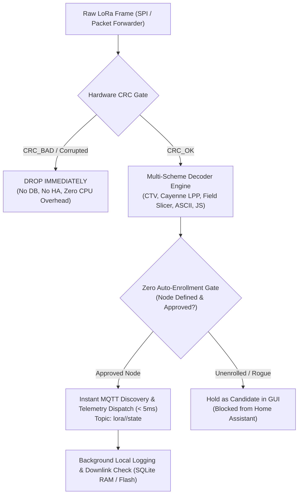

# LoRa Telemetry Pipeline, Decoder Studio, Home Assistant & MQTT Suite

A complete, high-performance LoRa telemetry processing suite, interactive Web Application (Decoder Studio, Home Assistant Manager, and MQTT Bridge), and gateway firmware designed for Dragino LoRa Gateways (**LPS8 SX1302** and **LG01/LG02 SX1276**) and remote edge systems (**Windows, Linux, macOS, Raspberry Pi, Docker, Home Assistant OS**).

---

## 1. Web Application Features & Navigation Tabs

The Web Interface provides a complete, unified management console accessible in any web browser (`http://localhost:8080`):

```
┌──────────────────────────────────────────────────────────────────────────────────────────────────┐
│  📡 LoRa Gateway Studio [Suite v2.2]                     ● Broker: Connected (192.168.1.13:1883) │
├──────────────────────────┬─────────────────────────────┬───────────────────────┬─────────────────┤
│ 🔬 Payload Decoder Studio│ 🏠 Home Assistant Integrat. │ 📨 MQTT Broker & Bridge│ 📊 Live Traffic │
└──────────────────────────┴─────────────────────────────┴───────────────────────┴─────────────────┘
```

### 🔬 Tab 1: Payload Decoder Studio
- **Visual Byte Slicer:** Interactively maps byte ranges (`[0..1] Node ID`, `[2..5] Serial`, `[6..7] Temp`) with live hex color tagging.
- **Scheme Manager:** Create, edit, clone, delete, test, and reorder decoder schemes with auto-saving to `decoders.json`.
- **Live Payload Workbench:** Test live hex payloads with instant decoded JSON preview and discrete metric tiles.
- **Smart Candidate Suppression:** Automatically hides the "Add Candidate" button when a node is already mapped and decoded.

### 🏠 Tab 2: Home Assistant Integration
- **Strict Zero Auto-Enrollment Security Gate:** Prevents rogue nodes or bleed-through packets from neighboring networks from polluting Home Assistant. Only approved nodes with defined schemes publish discovery entities.
- **Enrolled Devices Table:** View enrolled nodes (`Node CAFE`, `Node AA0B`), device serials, discovered sensor metrics, and live status.
- **1-Click Live Telemetry Dispatch:** Instantly publish sample telemetry (`lora/<node_id>/state`) to verify real-time dashboard updates in Home Assistant without waiting for radio broadcasts.
- **1-Click Auto-Discovery Sync:** Dispatches entity configs (`homeassistant/sensor/<node_id>_<metric>/config`) for all approved nodes.
- **1-Click Ghost Entity Purge:** Sends empty retained discovery payloads to wipe out obsolete or ghost sensors from Home Assistant.

### 📨 Tab 3: MQTT Broker & Bridge
- **Broker Connection Settings:** Configure Host IP (`192.168.1.13`), Port (`1883`), Username, Password, Discovery Prefix (`homeassistant`), and Telemetry State Prefix (`lora`).
- **Live Ping & Connection Tester:** 1-click test button verifies TCP and MQTT v3.1.1 connectivity with real-time latency measurement.
- **Direct Telemetry Publisher:** Publish custom MQTT JSON payloads directly to test node downlinks and Home Assistant reactions.

### 📊 Tab 4: Live Packet Traffic
- **Real-Time Radio Ingestion Stream:** Displays live incoming packets with timestamp, Frequency, RSSI, SNR, Size, Raw Hex, and Decoded metrics.
- **Hardware CRC Gate Status:** Color-coded badges for `CRC_OK` vs `CRC_BAD` (corrupted packets dropped at line 0).
- **1-Click Byte Slicing:** Click `🔬 Slice` on any live packet to load it directly into the Decoder Studio workbench.

---

## 2. Universal Quick Start (Any Operating System)

The suite runs on **any machine**, regardless of whether you have Python, Node.js, Lua, or **none of them installed**:

### On Windows (PowerShell or Command Prompt / CMD)
```powershell
cd standalone

# Option 1: 1-Click Batch Launcher (Double-click run.bat in File Explorer)
.\run.bat

# Option 2: PowerShell Universal Launcher
.\run.ps1

# Option 3: Zero-Install Direct Browser Mode (Zero dependencies!)
# Double-click 'index.html' in File Explorer, or run:
start index.html
```
> **Auto-Detection:** Automatically detects whether you have `py`, `python`, `node`, or `lua`. If no working runtime is detected (e.g. fresh Windows install with the Microsoft Store alias), it automatically launches `index.html` in your default browser in **Zero-Install Mode**.

### On Linux, macOS, Raspberry Pi, WSL, or Git Bash
```bash
cd standalone

# 1-Click Multi-Runtime Test Runner
./test.sh

# Launch Decoder Studio Web UI on port 8080
./test.sh --web 8080

# Run high-precision 5,000-packet benchmark
./test.sh --bench
```

---

## 3. High-Speed Pipeline Architecture & Execution Flow



---

## 4. Pipeline Speed & Real-World Latency Benchmarks

Performance was benchmarked across **5,000 real telemetry packets**:

| Target Platform & Architecture | Per-Packet Latency | Ingestion Throughput | Real-World Operational Context |
| :--- | :--- | :--- | :--- |
| **Dragino LPS8 (MIPS 24Kc @ 400 MHz)** | **2.58 ms** (0.00258 s) | **386.7 pkts / sec** | Easily processes peak multi-channel traffic with zero queueing delay (LoRa 1% duty cycle limit is ~10-25 pkts/sec). |
| **x86_64 PC / Server / Raspberry Pi 5** | **56.8 µs** (0.000057 s) | **17,602 pkts / sec** | Instant sub-millisecond execution when running offloaded or in Docker / Home Assistant OS. |

---

## 5. Standalone Directory Layout

```
standalone/
├── run.bat                # 1-Click Windows Batch Launcher (Auto-detects py/python/node/browser)
├── run.ps1                # 1-Click Windows PowerShell Launcher
├── test.bat / test.ps1    # Windows Test Suites
├── test.sh                # 1-Click Linux / Mac / WSL Test Runner & Web Launcher
├── index.html             # Standalone 4-Tab Web Application
├── config.json            # MQTT Broker, Gateway & Topic Configuration
├── decoders.json          # Configured Decoder Schemes (Node CAFE, Cayenne LPP, TLV, ASCII)
├── web/                   # Dedicated Web UI Assets:
│   ├── index.html         # Web Studio UI
│   ├── config.json        # Configuration
│   ├── decoders.json      # Schemes Specification
│   └── lora_decoder.js    # Visual Slicer & In-Browser Decoder Engine
├── web_server.py          # Zero-dependency Python 3 Web Server & MQTT Bridge
├── web_server.js          # Zero-dependency Node.js Web Server & MQTT Bridge
├── lora_decoder.lua       # Multi-Scheme Decoder Engine (Pure arithmetic Lua)
├── lora_decoder.js        # Universal JS Decoder (Node.js & Browser dual-environment)
├── pipeline.lua           # Strict Hardware CRC Integrity Gate & Ingestion Pipeline
├── ha_bridge.lua          # Home Assistant MQTT Auto-Discovery & Instant Telemetry
├── service.lua            # Unified CLI Runner, Daemon, File Watcher & Web Launcher
├── benchmark_pipeline.lua # High-precision 5,000-packet latency & throughput benchmark
├── test_standalone.js     # Node.js Test Runner
├── test_standalone.py     # Python 3 Test Runner
└── README.md              # Operational Documentation
```

---

## 6. 1-Click Gateway Deployment

To deploy this entire suite (GUI, pipeline, decoder, and Home Assistant bridge) directly to a live Dragino gateway:

```bash
chmod +x deploy.sh
./deploy.sh 192.168.1.17 root root
```
