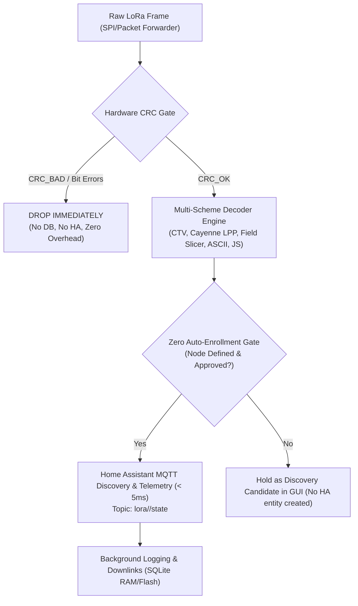

# LoRa Telemetry Pipeline, Decoder Studio & Home Assistant Integration

A complete, high-speed LoRa payload decoding pipeline, interactive LuCI Web GUI (Decoder Studio), and Home Assistant MQTT integration for Dragino LoRa gateways (LPS8 SX1302 and LG01/LG02 SX1276) and standalone edge devices.

---

## Architecture Overview



---

## Directory Structure

```
.
├── gui/                         # Complete LuCI Web GUI & Visual Slicer
│   ├── luci/
│   │   ├── controller/lora.lua  # REST APIs (decoders, packets, nodes, mqtt, downlinks)
│   │   ├── model/cbi/lora/      # Gateway config model
│   │   └── view/lora/           # HTML templates:
│   │       ├── decoder.htm      # LoRa Payload Decoder Studio (Multi-scheme editor & tester)
│   │       ├── status.htm       # Live Packet Stream & Real-time Traffic Inspector
│   │       ├── nodes.htm        # LoRa Node Registry & Home Assistant Enrolment Management
│   │       ├── config.htm       # Radio & MQTT Configuration
│   │       ├── diag.htm         # Spectrum & Diagnostics
│   │       └── log.htm          # System logs
│   └── www/
│       ├── luci-static/resources/lora_decoder.js  # Interactive Visual Byte Segmentation Engine
│       └── images/              # Hardware pinout & architectural diagrams
│
├── pipeline/                    # Telemetry Intake & Processing Pipeline
│   ├── lora_linking_engine.lua  # Ultra-low-latency linking, CRC gate & telemetry dispatcher
│   ├── pipeline.lua             # Pure Lua CRC gate & ingestion pipeline module
│   ├── lora_db_init.sh          # Dual SQLite database schema setup (Flash /etc/lora & RAM /tmp)
│   ├── lora_keepalive.sh        # Service supervisor & auto-respawn watchdog
│   └── lora_sync_config.sh      # Configuration synchronizer
│
├── decoder/                     # Multi-Scheme Payload Decoder
│   ├── lora_decoder.lua         # Multi-scheme decoding engine (CTV, Cayenne LPP, Field Slicer, ASCII)
│   └── decoders.json            # Active schemes specification (Node CAFE, Cayenne LPP, TLV, ASCII)
│
├── homeassistant/               # Home Assistant MQTT Integration
│   ├── ha_bridge.lua            # Tailored MQTT auto-discovery & instant telemetry dispatch
│   └── lora_mqtt_bridge.lua     # Gateway Device discovery, topology & downlink bridge
│
├── standalone/                  # Portable Standalone Service Runner
│   ├── service.lua              # CLI runner, daemon & file watcher (Runs on Pi, HA OS, PC, Docker)
│   ├── lora_decoder.lua         # Standalone decoder
│   ├── pipeline.lua             # Standalone pipeline
│   ├── ha_bridge.lua            # Standalone HA bridge
│   ├── decoders.json            # Decoder schemes
│   └── README.md                # Standalone documentation
│
├── files/                       # Ready-to-flash OpenWrt rootfs overlay tree
│   ├── etc/
│   ├── usr/
│   └── www/
│
├── deploy.sh                    # 1-Click live gateway deployer script
└── .gitignore
```

---

## 1-Click Gateway Deployment

Deploy the entire GUI, pipeline, decoder, and Home Assistant bridge directly to a running Dragino gateway over network:

```bash
chmod +x deploy.sh
./deploy.sh 192.168.1.17 root root
```

This installs all views, controllers, engines, and services, clears LuCI caches, and restarts the pipeline.

---

## Standalone Execution (External Device / Raspberry Pi / Docker)

To run the pipeline and decoding service remotely on another computer:

```bash
cd standalone
lua service.lua --watch /tmp/lora_packets.json --broker 192.168.1.13 --user admin --pass admin
```

Or test a single payload via CLI:

```bash
lua service.lua --hex CAFE96B840EB010201490271FFFB00180421036700B404880000000000000000
```
