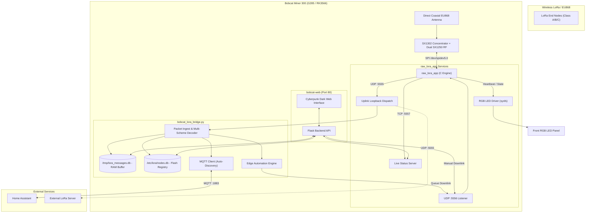

# Bobcat Miner 300 (G285 / RK3566) Custom LoRa Gateway & Telemetry Appliance

Transform any **Bobcat Miner 300 (Model G285, Rockchip RK3566)** running Armbian Linux into a high-performance, standalone LoRa gateway and telemetry engine.

This firmware provides full native Semtech SX1302 concentrator support, real-time multi-scheme packet decoding, dual SQLite persistence, Home Assistant MQTT auto-discovery, edge automations, an industrial RGB LED status state machine, and a dark cyberpunk web management interface.

---

## 🌟 Key Features

- **Native SX1302 Concentrator Engine**:
  - Full Semtech SX1302 HAL compiled for ARM64 Linux.
  - 8-channel simultaneous reception on EU868 with configurable IF offsets.
  - Native **27 dBm (500 mW)** transmission power with calibrated 16-point LUT.
  - Dual loopback mirroring: sends uplinks to external remote servers and internal `127.0.0.1:5555` simultaneously.
  - Automatic hardware power-sequencing and reset via Rockchip GPIOs (125, 122, 149).

- **Industrial RGB LED State Machine**:
  - **Green Biological Heartbeat**: Double-pulse rhythm (`80ms ON / 140ms OFF / 80ms ON / 900ms OFF`) indicating normal, healthy operation.
  - **Pure Blue Flash**: 180 ms pulse triggered upon packet transmission (TX).
  - **Pure Red Flash**: 120 ms pulse triggered upon packet reception (RX).
  - **Fast Flashing Red**: SX1302 HAL error or hardware fault (`100ms ON / 100ms OFF`).
  - **Flashing Yellow**: Network gateway unreachable (`200ms ON / 200ms OFF`).
  - **Solid Red**: Fallback watchdog alert if `raw_lora_app` crashes or stops.

- **Multi-Scheme Decoders & Live Workbench**:
  - Decode raw hex payloads in real time without external cloud services.
  - Built-in schemes: **AA0B** (telemetry/battery/temperature), **AA0C** (actuator/relay), **Cayenne LPP** (standard IPSO), **ASCII** (strings/pings), and configurable visual byte-range slicers.
  - Interactive web sandbox with byte-by-byte breakdown pills and instant JSON preview.
  - Scheme CRUD editor saving to `/etc/lora/decoders.json`.

- **Dual-Database Architecture**:
  - `/etc/lora/nodes.db` on persistent Flash: node registry, device profiles (Class A/B/C), and edge automation linking rules.
  - `/tmp/lora_messages.db` on tmpfs RAM: circular rolling buffer storing the last 50 packets per device via SQLite triggers (zero SD/eMMC wear).

- **Home Assistant & MQTT Integration**:
  - Automatic MQTT discovery (`homeassistant/sensor/...`) for adopted devices.
  - Bidirectional downlink control: publish to `lora/<node_id>/set` to dispatch LoRa downlinks to UDP port 5556.

- **Direct Edge Automations Engine ("What is Linked to What and How")**:
  - Define local gateway rules: trigger downlinks, HTTP webhooks, or MQTT events directly upon sensor thresholds.
  - Built-in Listen-Before-Talk (LBT), cooldown timers, turnaround delays, and execution audit log.

- **Cyberpunk Dark Web Management Interface (Port 80)**:
  - Futuristic dark UI (`#0a0d14`, neon cyan `#00f0ff`, JetBrains Mono).
  - Real-time HAL metrics, noise floor, temperature monitoring, packet sniffer, node table, and system controls.

- **Pure DHCP Client (Zero Network Conflicts)**:
  - Operates strictly as a transparent DHCP client on both Ethernet and Wi-Fi.
  - No internal DHCP server, preventing network IP loops or gateway freezes.

---

## 📐 Architecture Diagram



---

## 🚀 Quick Start / Installation

Converting a Bobcat Miner 300 running Armbian into this appliance takes only a single step:

```bash
# 1. Clone the repository branch
git clone -b bobcat-miner-300 https://github.com/nor24o/custom-lps8-firmware.git /opt/bobcat-firmware
cd /opt/bobcat-firmware

# 2. Run the automated installer as root
sudo ./install.sh
```

The installer will:
1. Lock kernel/U-Boot packages to protect against bootloader corruption.
2. Install dependencies (`gcc`, `make`, `python3-flask`, `python3-paho-mqtt`, `sqlite3`, etc.).
3. Compile the SX1302 HAL, `chip_id`, and `raw_lora_app` natively.
4. Install all services, configuration files, and initialize the databases.
5. Enable and start `raw-lora`, `bobcat-lora-bridge`, and `bobcat-web`.
6. Start the Green biological heartbeat on the front panel.

Once complete, open `http://<bobcat-ip>/` in your browser.

---

## 🛠️ Hardware Reference & Wiring

| Function | Pin / Sysfs Path | Details |
| :--- | :--- | :--- |
| **LoRa SPI Bus** | `/dev/spidev5.0` | SPI Controller 5, Chip Select 0 @ 8 MHz |
| **LoRa Power Rail 1** | `/sys/class/gpio/gpio125` | GPIO3_D5 — Must be HIGH for power |
| **LoRa Power Rail 2** | `/sys/class/gpio/gpio122` | GPIO3_D2 — Must be HIGH for power |
| **LoRa Hardware Reset** | `/sys/class/gpio/gpio149` | GPIO4_B5 — Active HIGH pulse (100 ms) |
| **Physical RED LED** | `/sys/class/leds/red:status` | GPIO 130 (`GPIO4_A2`) |
| **Physical GREEN LED** | `/sys/class/leds/blue:status` | GPIO 128 (`GPIO4_A0`) — *sysfs label inverted* |
| **Physical BLUE LED** | `/sys/class/leds/green:status` | GPIO 129 (`GPIO4_A1`) — *sysfs label inverted* |

See [docs/BOBCAT_HARDWARE_AND_PINOUT.md](docs/BOBCAT_HARDWARE_AND_PINOUT.md) for full hardware details.

---

## 💡 Front RGB LED Status Guide

| LED Pattern | Meaning |
| :--- | :--- |
| **Green Double-Pulse Heartbeat** | Everything OK, gateway actively listening |
| **Pure Blue Flash (180ms)** | LoRa packet transmission (TX) |
| **Pure Red Flash (120ms)** | LoRa packet reception (RX) |
| **Fast Flashing Red (100ms)** | SX1302 HAL error or SPI failure |
| **Flashing Yellow (200ms)** | Network gateway unreachable |
| **Solid Cyan** | Gateway initializing and calibrating |
| **Solid Red** | Software watchdog alert (`raw_lora_app` down) |

---

## 💻 CLI Commands

The installation provides helper utilities available in `/usr/local/bin`:

```bash
# Test the SX1302 SPI bus and read the silicon chip ID
test-lora

# Test all RGB LED colors sequentially
test-leds

# Query live statistics from raw_lora_app (TCP 5557)
query-lora-status

# Send a test downlink packet (UDP 5556)
send-lora-packet
```

## Local UDP JSON protocol

The versioned gateway/control/telemetry contract is documented in
[docs/LOCAL_PROTOCOL.md](docs/LOCAL_PROTOCOL.md). A dependency-free receiver
example is available at
[examples/lora_udp_receiver.py](examples/lora_udp_receiver.py):

```bash
python3 examples/lora_udp_receiver.py --bind 0.0.0.0 --port 9999
```

---

## 🌐 Web Interface Tabs

- **Dashboard**: Live system health, CPU/RAM, concentrator uptime, RX/TX counters, noise floor.
- **Radio & HAL**: 8-channel frequency allocations, RF front-end gain, TX power LUT configuration.
- **🧩 Decoders & Workbench**: Real-time packet test sandbox, visual byte pills, custom scheme CRUD.
- **📱 Nodes & Home Assistant**: Device registry, RSSI/SNR signal meters, Class A/B/C parameters, HA discovery toggles, rolling 50-message history, and downlink dispatch modal.
- **⚡ Device Automations**: Edge linking rules ("What is linked to what and how"), manual trigger test, and execution audit log.
- **Network & System**: Ethernet / Wi-Fi IP configuration, hostname management, system reboot, and service restart controls.
- **Hardware & Pins**: Interactive hardware pinout reference and LED test triggers.

---

## 📄 License

GPL-2.0 / BSD 3-Clause (Semtech SX1302 HAL).
See `sx1302_hal/LICENSE.TXT` for details.
