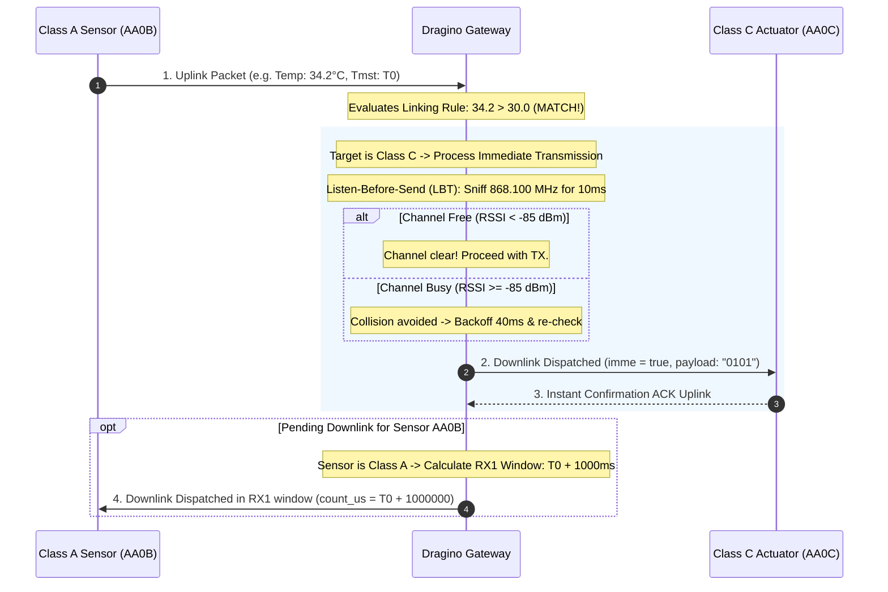
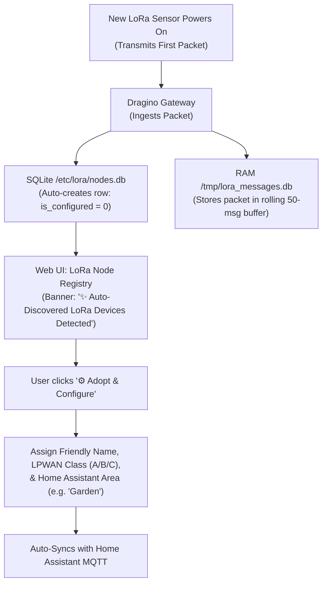
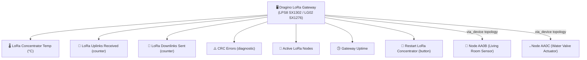

# LPWAN Device Classes, SQLite Storage, & Autonomous Linking Reference

This document serves as the complete technical reference for developing, registering, and linking LoRa devices with the custom Dragino gateway firmware (LPS8 SX1302 and LG01/LG02 SX1276).

---

## 1. LPWAN Device Classes Overview

LoRa devices are categorized into three distinct classes depending on power availability and downlink responsiveness:

```
┌─────────────────────────────────────────────────────────────────────────────┐
│                             LPWAN DEVICE CLASSES                            │
├─────────────────────┬───────────────────────────────┬───────────────────────┤
│ Class A (Battery)   │ Class B (Beacon / Ping Slots) │ Class C (Mains / 12V) │
├─────────────────────┼───────────────────────────────┼───────────────────────┤
│ • Sleeps 99.9%      │ • Sleeps between slots        │ • Never sleeps        │
│ • Opens RX1 / RX2   │ • Opens brief ping slots on   │ • Receiver is ALWAYS  │
│   windows only      │   a synchronized timer        │   listening           │
│   AFTER sending an  │ • Gateway can downlink at any │ • Gateway downlinks   │
│   uplink            │   scheduled slot              │   IMMEDIATELY         │
│ • Maximum battery   │ • Moderate battery life       │ • High power draw     │
│   life (years)      │                               │                       │
│ • Downlinks are     │ • Downlinks are queued for    │ • Zero latency        │
│   QUEUED in gateway │   next slot                   │   actuation           │
└─────────────────────┴───────────────────────────────┴───────────────────────┘
```

---

## 2. Downlink Timing & Listen-Before-Send (LBT)

### Transmission Timeline



### Parameter Definitions

1. **Turnaround Delay (`turnaround_delay_ms`):**
   - **For Class A devices:** Standard LoRaWAN specifies an RX1 delay of **1,000 ms** (or custom up to 5,000 ms). The node transmits, turns off its radio to save power, and turns its receiver on exactly at $T_0 + 1000\text{ ms}$ for 500 ms.
   - **For Class C devices:** Configurable delay (typically 0–200 ms) before firing downlinks.

2. **Listen-Before-Send (LBT / Carrier Sense):**
   - Sniffs the channel carrier power (`rssic`) before transmitting.
   - If carrier power exceeds the threshold (e.g. `> -85 dBm`), another node is currently transmitting on that channel.
   - The gateway automatically backs off for a randomized interval (30–60 ms) and retries up to `max_retries` (default: 3) to prevent packet destruction.

3. **Cooldown Debounce (`cooldown_sec`):**
   - Minimum interval before a link rule is permitted to fire again.
   - If a sensor transmits every 5 seconds and stays above threshold, cooldown prevents flooding the airwaves with continuous downlinks.

4. **Auto-Reset Pulse (`pulse_sec`):**
   - Automatically schedules a return-to-idle or turn-off downlink after $X$ seconds (e.g., turn irrigation valve ON for 60 seconds, then automatically turn OFF).

---

## 3. Dual-Database SQLite Architecture

To eliminate SPI flash wear from high-frequency LoRa packets, data is split between persistent flash storage and ephemeral RAM:

```
┌─────────────────────────────────────────────────────────────────────────────┐
│ 1. Persistent Database: /etc/lora/nodes.db (SPI NOR Flash)                  │
├─────────────────────────────────────────────────────────────────────────────┤
│ • node_settings: Node identity, friendly name, Class (A/B/C), RX1 delays   │
│ • node_links:    Rules ("what is linked to what and how"), LBT, debounce    │
│ (Only written when you add/edit nodes or configure links. Survives reboot)  │
└─────────────────────────────────────────────────────────────────────────────┘

┌─────────────────────────────────────────────────────────────────────────────┐
│ 2. Ephemeral RAM Database: /tmp/lora_messages.db (tmpfs in RAM)              │
├─────────────────────────────────────────────────────────────────────────────┤
│ • node_messages:       Rolling 50 messages per node (auto-pruned by trigger)│
│ • pending_downlinks:   Queued downlinks for Class A nodes waiting for RX1   │
│ • link_execution_logs: Audit log of automatic link triggers and test runs   │
│ (Blazing fast in-memory execution, zero flash wear, ~200 KB RAM footprint) │
└─────────────────────────────────────────────────────────────────────────────┘
```

### Automatic Circular Buffer Trigger

Every insertion into `node_messages` automatically executes this trigger to guarantee no node stores more than 50 messages:

```sql
CREATE TRIGGER IF NOT EXISTS prune_node_history
AFTER INSERT ON node_messages
BEGIN
    DELETE FROM node_messages
    WHERE node_id = NEW.node_id
      AND id NOT IN (
          SELECT id FROM node_messages
          WHERE node_id = NEW.node_id
          ORDER BY id DESC
          LIMIT 50
      );
END;
```

---

## 4. REST API Reference

The LuCI controller exposes the following JSON endpoints on the gateway:

| Endpoint | Method | Description |
| :--- | :--- | :--- |
| `/cgi-bin/luci/admin/lora/api_nodes` | `GET` | Returns list of registered nodes with signal stats and class |
| `/cgi-bin/luci/admin/lora/api_nodes` | `POST` | Registers or updates a node profile (`node_id`, `name`, `node_class`, `rx1_delay_ms`) |
| `/cgi-bin/luci/admin/lora/api_nodes?node_id=AA0B` | `DELETE` | Removes node from registry |
| `/cgi-bin/luci/admin/lora/api_node_history?node_id=AA0B` | `GET` | Fetches the rolling 50 messages for a specific node from SQLite |
| `/cgi-bin/luci/admin/lora/api_links` | `GET` | Returns all autonomous linking rules |
| `/cgi-bin/luci/admin/lora/api_links` | `POST` | Creates or updates a linking rule |
| `/cgi-bin/luci/admin/lora/api_links?link_id=1` | `DELETE` | Deletes a linking rule |
| `/cgi-bin/luci/admin/lora/api_link_test` | `POST` | Dispatches an interactive test downlink with LBT and delay logging |
| `/cgi-bin/luci/admin/lora/api_link_simulate` | `POST` | Tests rule matching against mock data without RF transmission |
| `/cgi-bin/luci/admin/lora/api_link_logs` | `GET` | Returns recent execution and audit logs |

---

## 5. Downlink UDP Packet Format (Port 5556)

When the linking engine or LuCI dispatches a downlink, it transmits a JSON datagram to `127.0.0.1:5556`:

```json
{
  "imme": true,
  "tmst": 4291847102,
  "freq": 868.100,
  "rfch": 0,
  "powe": 14,
  "modu": "LORA",
  "datr": "SF7BW125",
  "codr": "4/5",
  "ipol": false,
  "size": 14,
  "data": "AQEB..."
}
```

- `imme`: `true` for **Class C** (instant TX); `false` for **Class A** (timestamped TX).
- `tmst`: Hardware timestamp in microseconds (used when `imme = false`).
- `data`: Standard Base64-encoded binary payload.

---

## 6. Home Assistant MQTT Auto-Discovery & Bidirectional Downlink Control

The gateway features a native Home Assistant MQTT bridge (`/usr/bin/lora_mqtt_bridge.lua`) that automatically discovers and manages all LoRa nodes over MQTT with sub-second responsiveness.

### Device Grouping & Categories in Home Assistant
When a node is discovered or transmits, the gateway automatically publishes standard Home Assistant MQTT discovery payloads with a unified `device` block:

```json
{
  "name": "Irrigation Valve Actuator",
  "unique_id": "lora_AA0C_switch",
  "state_topic": "lora/AA0C/state",
  "command_topic": "lora/AA0C/set",
  "payload_on": "ON",
  "payload_off": "OFF",
  "device": {
    "identifiers": ["lora_AA0C"],
    "name": "Irrigation Valve Actuator",
    "model": "LoRa Actuator (Class C)",
    "manufacturer": "Custom Dragino Gateway",
    "suggested_area": "Garden"
  }
}
```

- **Unified Device Card**: In Home Assistant (Settings $\rightarrow$ Devices & Services $\rightarrow$ MQTT), all entities associated with `lora_AA0C` (e.g. Switch, RSSI, Battery) are automatically grouped together under **one device card**.
- **Categorization**: The node's `group_name` in SQLite is mapped directly to Home Assistant's `suggested_area` (e.g. "Garden", "Greenhouse", "Living Room").

### Bidirectional Control Pipeline (Downlinks from Home Assistant)

```mermaid
flowchart LR
    HA["Home Assistant Dashboard<br/>(Toggle Switch 'ON')"] -->|"Publish 'ON'<br/>Topic: lora/AA0C/set"| Broker["MQTT Broker<br/>(Mosquitto)"]
    Broker -->|"mosquitto_sub listener"| Bridge["lora_mqtt_bridge.lua<br/>(Dragino Gateway)"]
    Bridge -->|"1. LBT Noise Sniff<br/>2. Translate 'ON' -> 0x0101"| HAL["Concentrator UDP 5556<br/>(raw_lora_app)"]
    HAL -->|"LoRa TX (868.1 MHz, SF7)"| Node["Target Actuator Node<br/>(Class C Valve / Relay)"]
    Bridge -->|"Publish State: {'state':'ON'}<br/>Topic: lora/AA0C/state"| Broker
    Broker -->|"Instant UI confirmation"| HA
```



1. **User Action:** You toggle a switch or run an automation in Home Assistant.
2. **Command Dispatch:** Home Assistant publishes `ON` or `OFF` to `lora/<NODE_ID>/set`.
3. **Gateway Ingestion:** The gateway's `lora_mqtt_bridge.lua` receives the message in real-time.
4. **LBT & Downlink:** It checks the node's class in SQLite, sniffs the RF channel for carrier activity, and dispatches the binary frame over LoRa.
5. **State Synchronization:** It immediately updates `lora/<NODE_ID>/state` so the switch state in Home Assistant reflects reality without lag.

---

## 7. Zero-Touch Automatic Node Discovery & Adoption Workflow

You **do not** need to manually register nodes before they can transmit. The gateway operates on a **zero-touch auto-discovery** model:



### Auto-Discovery Lifecycle
1. **Packet Detection:** The moment an unknown node transmits (e.g. `B827`), `lora_linking_engine.lua` automatically inserts it into `/etc/lora/nodes.db` with `is_configured = 0` and `group_name = 'Unassigned'`.
2. **Buffer Capture:** Its decoded telemetry is saved immediately to the circular 50-message buffer in RAM.
3. **Web UI Alert:** The Node Registry tab highlights the node with a `✨ Auto-Discovered` badge and displays the alert banner at the top of the page.
4. **Adoption & Customization:**
   - Click **⚙️ Adopt & Configure** on the node card.
   - Choose its Friendly Name (e.g. `Greenhouse Soil Probe`).
   - Select LPWAN Class (`Class A` for battery sensors, `Class C` for continuous actuators).
   - Set Area / Group (e.g. `Greenhouse`).
   - Click **Save Node to SQLite**.
5. **Home Assistant Registration:** The gateway immediately updates Home Assistant via MQTT Discovery under the specified Area.
6. **Edge Automation:** Click **🔗 Link** next to the adopted node to configure autonomous edge linking rules (e.g. if temperature exceeds 30°C, trigger valve `AA0C`).

---

## 8. Gateway Self-Discovery & Child Device Topology in Home Assistant

The Dragino Gateway automatically registers **itself** as a primary infrastructure device in Home Assistant while grouping all detected LoRa sensors and actuators underneath it as child devices.



### Gateway Entities in Home Assistant

| Entity Name | Type | Topic | Function |
|---|---|---|---|
| **LoRa Concentrator Temperature** | `sensor` | `lora/gateway/state` | Live on-chip SX1302 thermal telemetry (`°C`). |
| **LoRa Uplinks Received** | `sensor` | `lora/gateway/state` | Cumulative counter of successfully ingested packets. |
| **LoRa Downlinks Sent** | `sensor` | `lora/gateway/state` | Cumulative counter of transmitted LoRa frames. |
| **LoRa CRC Errors** | `sensor` | `lora/gateway/state` | RF integrity diagnostics for interference detection. |
| **Active LoRa Nodes** | `sensor` | `lora/gateway/state` | Count of registered nodes currently managed by SQLite. |
| **Radio State** | `sensor` | `lora/gateway/state` | Live status (`LISTENING`, `TX_FREE`, etc.). |
| **Gateway Uptime** | `sensor` | `lora/gateway/state` | Concentrator daemon runtime in hours. |
| **Radio Online** | `binary_sensor` | `lora/gateway/state` | Connectivity status (`ON` / `OFF`). |
| **Restart LoRa Concentrator** | `button` | `lora/gateway/restart` | Sends `PRESS` to safely reset and re-initialize the LoRa radio without rebooting the router. |

### Connected Child Devices Topology (`via_device`)
Every LoRa sensor and actuator published to Home Assistant includes the Gateway EUI in its `via_device` attribute:
- **In Home Assistant Gateway Card:** A dedicated **"Connected Devices"** panel lists all your LoRa nodes with one-click navigation to their sensors and switches.
- **In Node Cards:** The card displays **"Connected via: Dragino LoRa Gateway"** and provides a one-click link back to the gateway and its LuCI web dashboard (`Visit Device`).


