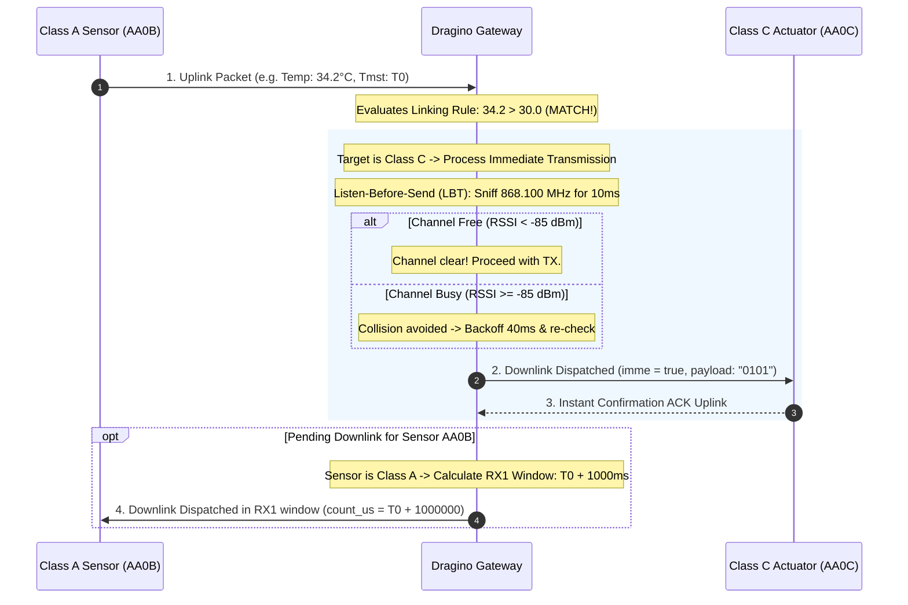

# LPWAN Device Classes, SQLite Storage, & Autonomous Linking Reference

This document serves as the complete technical reference for developing, registering, and linking LoRa devices with the custom Dragino gateway firmware (LPS8 SX1302 and LG01/LG02 SX1276).

---

## 1. LPWAN Device Classes Overview

LoRa devices are categorized into three distinct classes depending on power availability and downlink responsiveness:

```
┌─────────────────────────────────────────────────────────────────────────────┐
│                             LPWAN DEVICE CLASSES                            │
├─────────────────────┬───────────────────────────────┬───────────────────────┤
│ Class A (Battery)   │ Class B (Beacon / Ping Slots) │ Class C (Mains / 12V) │
├─────────────────────┼───────────────────────────────┼───────────────────────┤
│ • Sleeps 99.9%      │ • Sleeps between slots        │ • Never sleeps        │
│ • Opens RX1 / RX2   │ • Opens brief ping slots on   │ • Receiver is ALWAYS  │
│   windows only      │   a synchronized timer        │   listening           │
│   AFTER sending an  │ • Gateway can downlink at any │ • Gateway downlinks   │
│   uplink            │   scheduled slot              │   IMMEDIATELY         │
│ • Maximum battery   │ • Moderate battery life       │ • High power draw     │
│   life (years)      │                               │                       │
│ • Downlinks are     │ • Downlinks are queued for    │ • Zero latency        │
│   QUEUED in gateway │   next slot                   │   actuation           │
└─────────────────────┴───────────────────────────────┴───────────────────────┘
```

---

## 2. Downlink Timing & Listen-Before-Send (LBT)

### Transmission Timeline



### Parameter Definitions

1. **Turnaround Delay (`turnaround_delay_ms`):**
   - **For Class A devices:** Standard LoRaWAN specifies an RX1 delay of **1,000 ms** (or custom up to 5,000 ms). The node transmits, turns off its radio to save power, and turns its receiver on exactly at $T_0 + 1000\text{ ms}$ for 500 ms.
   - **For Class C devices:** Configurable delay (typically 0–200 ms) before firing downlinks.

2. **Listen-Before-Send (LBT / Carrier Sense):**
   - Sniffs the channel carrier power (`rssic`) before transmitting.
   - If carrier power exceeds the threshold (e.g. `> -85 dBm`), another node is currently transmitting on that channel.
   - The gateway automatically backs off for a randomized interval (30–60 ms) and retries up to `max_retries` (default: 3) to prevent packet destruction.

3. **Cooldown Debounce (`cooldown_sec`):**
   - Minimum interval before a link rule is permitted to fire again.
   - If a sensor transmits every 5 seconds and stays above threshold, cooldown prevents flooding the airwaves with continuous downlinks.

4. **Auto-Reset Pulse (`pulse_sec`):**
   - Automatically schedules a return-to-idle or turn-off downlink after $X$ seconds (e.g., turn irrigation valve ON for 60 seconds, then automatically turn OFF).

---

## 3. Dual-Database SQLite Architecture

To eliminate SPI flash wear from high-frequency LoRa packets, data is split between persistent flash storage and ephemeral RAM:

```
┌─────────────────────────────────────────────────────────────────────────────┐
│ 1. Persistent Database: /etc/lora/nodes.db (SPI NOR Flash)                  │
├─────────────────────────────────────────────────────────────────────────────┤
│ • node_settings: Node identity, friendly name, Class (A/B/C), RX1 delays   │
│ • node_links:    Rules ("what is linked to what and how"), LBT, debounce    │
│ (Only written when you add/edit nodes or configure links. Survives reboot)  │
└─────────────────────────────────────────────────────────────────────────────┘

┌─────────────────────────────────────────────────────────────────────────────┐
│ 2. Ephemeral RAM Database: /tmp/lora_messages.db (tmpfs in RAM)              │
├─────────────────────────────────────────────────────────────────────────────┤
│ • node_messages:       Rolling 50 messages per node (auto-pruned by trigger)│
│ • pending_downlinks:   Queued downlinks for Class A nodes waiting for RX1   │
│ • link_execution_logs: Audit log of automatic link triggers and test runs   │
│ (Blazing fast in-memory execution, zero flash wear, ~200 KB RAM footprint) │
└─────────────────────────────────────────────────────────────────────────────┘
```

### Automatic Circular Buffer Trigger

Every insertion into `node_messages` automatically executes this trigger to guarantee no node stores more than 50 messages:

```sql
CREATE TRIGGER IF NOT EXISTS prune_node_history
AFTER INSERT ON node_messages
BEGIN
    DELETE FROM node_messages
    WHERE node_id = NEW.node_id
      AND id NOT IN (
          SELECT id FROM node_messages
          WHERE node_id = NEW.node_id
          ORDER BY id DESC
          LIMIT 50
      );
END;
```

---

## 4. REST API Reference

The LuCI controller exposes the following JSON endpoints on the gateway:

| Endpoint | Method | Description |
| :--- | :--- | :--- |
| `/cgi-bin/luci/admin/lora/api_nodes` | `GET` | Returns list of registered nodes with signal stats and class |
| `/cgi-bin/luci/admin/lora/api_nodes` | `POST` | Registers or updates a node profile (`node_id`, `name`, `node_class`, `rx1_delay_ms`) |
| `/cgi-bin/luci/admin/lora/api_nodes?node_id=AA0B` | `DELETE` | Removes node from registry |
| `/cgi-bin/luci/admin/lora/api_node_history?node_id=AA0B` | `GET` | Fetches the rolling 50 messages for a specific node from SQLite |
| `/cgi-bin/luci/admin/lora/api_links` | `GET` | Returns all autonomous linking rules |
| `/cgi-bin/luci/admin/lora/api_links` | `POST` | Creates or updates a linking rule |
| `/cgi-bin/luci/admin/lora/api_links?link_id=1` | `DELETE` | Deletes a linking rule |
| `/cgi-bin/luci/admin/lora/api_link_test` | `POST` | Dispatches an interactive test downlink with LBT and delay logging |
| `/cgi-bin/luci/admin/lora/api_link_simulate` | `POST` | Tests rule matching against mock data without RF transmission |
| `/cgi-bin/luci/admin/lora/api_link_logs` | `GET` | Returns recent execution and audit logs |

---

## 5. Downlink UDP Packet Format (Port 5556)

When the linking engine or LuCI dispatches a downlink, it transmits a JSON datagram to `127.0.0.1:5556`:

```json
{
  "imme": true,
  "tmst": 4291847102,
  "freq": 868.100,
  "rfch": 0,
  "powe": 14,
  "modu": "LORA",
  "datr": "SF7BW125",
  "codr": "4/5",
  "ipol": false,
  "size": 14,
  "data": "AQEB..."
}
```

- `imme`: `true` for **Class C** (instant TX); `false` for **Class A** (timestamped TX).
- `tmst`: Hardware timestamp in microseconds (used when `imme = false`).
- `data`: Standard Base64-encoded binary payload.
